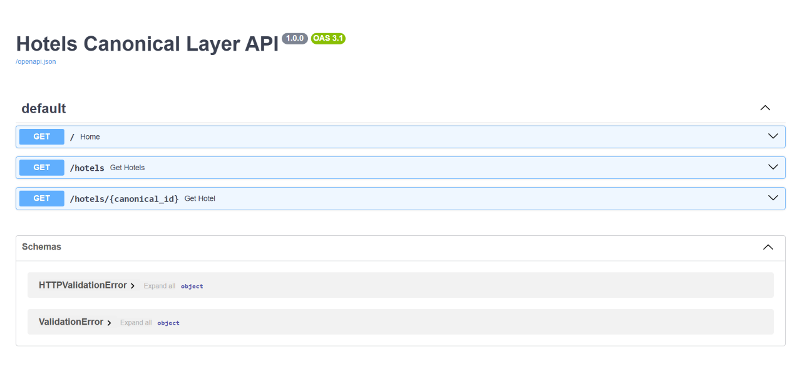
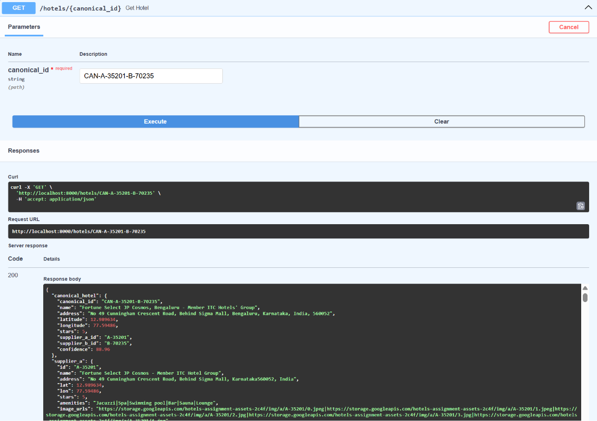

# Hotels Canonical Layer API

A FastAPI-based canonical hotel layer that merges duplicate hotel records from two independent suppliers into a unified dataset with confidence scoring, room canonicalization, and source provenance.

Built as part of the Away AI Engineering Intern Take-Home Assignment.

---

# Features

- Hotel entity resolution across two supplier datasets
- Geographic candidate generation (blocking)
- Confidence-based hotel matching
- Canonical hotel generation with provenance
- Room canonicalization for matched hotels
- Room attribute normalization
- Persisted canonical hotel and room artifacts
- FastAPI REST API
- Swagger/OpenAPI documentation
- Dockerized deployment

---

# Project Structure

```text
hotels-canonical-layer/
│
├── app/
│   ├── pipeline/
│   │   ├── blocking.py
│   │   ├── hotel_matcher.py
│   │   ├── ingestion.py
│   │   ├── merger.py
│   │   ├── room_alignment.py
│   │   ├── room_canonicalizer.py
│   │   └── room_matcher.py
│   │
│   └── main.py
│
├── data/
│   ├── supplier_a.csv
│   ├── supplier_b.csv
│   ├── rooms_a.csv
│   └── rooms_b.csv
│
├── docs/
│   ├── swagger-ui.png
│   └── hotel-response.png
│
├── output/
│   ├── canonical_hotels.json
│   └── canonical_rooms.json
│
├── scripts/
│   ├── blocking.py
│   ├── explore.py
│   ├── generate_canonical_rooms.py
│   ├── test_pipeline.py
│   └── test_rooms.py
│
├── .gitignore
├── Dockerfile
├── docker-compose.yml
├── requirements.txt
├── README.md
└── WRITEUP.md
```

---

# Requirements

Choose one of the following:

- Docker Desktop (Recommended)

or

- Python 3.13+
- pip

---

# Running the Project

## Option 1 (Recommended)

Clone the repository

```bash
git clone <repository-url>
cd hotels-canonical-layer
```

Build and start the API

```bash
docker compose up --build
```

The API will be available at

```
http://localhost:8000
```

Swagger UI

```
http://localhost:8000/docs
```

---

## Option 2 (Without Docker)

Install dependencies

```bash
pip install -r requirements.txt
```

Run the API

```bash
uvicorn app.main:app --reload
```

---

# Regenerating Canonical Room Artifact

If you regenerate room mappings:

```bash
python -m scripts.generate_canonical_rooms
```

This recreates

```
output/canonical_rooms.json
```

---

# Generated Artifacts

## Hotels

```
output/canonical_hotels.json
```

Contains

- Canonical Hotel ID
- Canonical Hotel Record
- Supplier A Reference
- Supplier B Reference
- Match Confidence

---

## Rooms

```
output/canonical_rooms.json
```

Contains

- Canonical Room ID
- Canonical Hotel ID
- Supplier Room References
- Normalized Attributes
- Match Confidence
- Match Status

Possible room statuses

- matched
- near_miss
- unmatched_a
- unmatched_b

---

# API Endpoints

## List Hotels

```
GET /hotels
```

Example

```
GET /hotels?search=fortune
```

Optional query parameters

| Parameter | Description |
|-----------|-------------|
| search | Search hotel name |
| min_confidence | Minimum confidence score |
| limit | Pagination limit |
| offset | Pagination offset |

---

## Hotel Details

```
GET /hotels/{canonical_id}
```

Example

```
GET /hotels/CAN-A-35201-B-70235
```

Returns

- Canonical Hotel
- Supplier A Record
- Supplier B Record
- Matched Rooms
- Near-Miss Room Candidates
- Unmatched Supplier A Rooms
- Unmatched Supplier B Rooms
- Hotel Confidence

---

# Matching Strategy

## Hotel Matching

To avoid an expensive Supplier A × Supplier B comparison, candidate hotels are first generated using geographic blocking.

Each candidate pair is scored using:

- Hotel name similarity
- Geographic distance
- Star rating comparison

Only matches with confidence ≥ 55 are accepted.

Hotels without a confident match are retained as single-source canonical hotels.

---

## Room Canonicalization

Room canonicalization is performed only for matched hotel pairs.

RapidFuzz token similarity is used to compare room names.

Each canonical room stores

- Canonical Room ID
- Canonical Hotel ID
- Supplier A Room ID
- Supplier B Room ID
- Normalized Attributes
- Confidence
- Match Status

Normalized attributes include

- Bed Type
- Occupancy
- Meal Plan
- View

Lower-confidence matches are preserved as **near_miss** instead of forcing an incorrect match.

Rooms without counterparts remain as

- unmatched_a
- unmatched_b

---

# Example API Screenshots

## Swagger UI



---

## Example Hotel Response



---

# Technologies Used

- Python
- FastAPI
- Pandas
- RapidFuzz
- Docker
- Uvicorn

---

# API Cost

```
$0
```

No paid APIs, external LLMs, or third-party services were used.

---

# Notes

- The API serves persisted canonical artifacts instead of recomputing matches for every request.
- Every canonical hotel maintains provenance back to the original supplier records.
- Room mappings preserve confidence scores and normalization metadata.
- The project is fully reproducible using only the provided datasets.

---

# Repository Contents

This repository contains

- Source code
- Docker configuration
- Canonical hotel artifact
- Canonical room artifact
- API implementation
- Technical write-up
- Example API screenshots